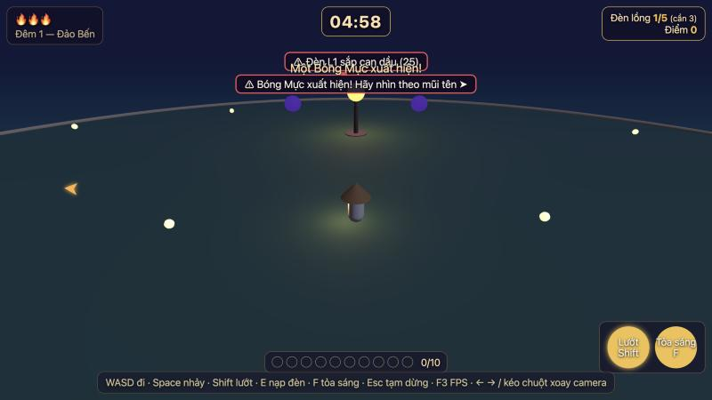

# Đảo Đèn Lồng

> **Demo video:** _(added by the author at release, see the GitHub Release v1.0.0)_



A small 3D third-person game, built for the Day 12 AI-SDLC lab. You play Mây, a young lantern keeper. Gather fireflies, light the Great Lanterns and **keep them burning until dawn** while the Bóng Mực (ink shades) try to drain them. Three nights, three islands, a local leaderboard.

Lab brief and rules: [docs/lab/](docs/lab/README.md). Specs: [docs/spec/](docs/spec/).

## System requirements
- macOS or Linux (Windows should work for the web build), 64-bit.
- **Node.js ≥ 20** and npm.
- A GPU/driver with WebGL 2 (any recent laptop). The desktop build bundles Chromium through Electron.
- Disk: about 400 MB for `node_modules` (Electron binary included). **The first `npm ci` downloads the Electron binary, so it needs network access.**
- A static web build (no Node needed to play) is attached to the GitHub Release: `dao-den-long-web-v1.0.0.zip`.

## Install and run (3 commands)
```bash
npm ci
npm run build
npx electron .
```
Browser alternative (no Electron window): `npm run dev`, or `npm run build && npm run preview`.

## Headless (Test Contract v1.3)
```bash
node dist/headless.js --seed 1 --night 1 --ticks 600 --out out/run.jsonl [--scenario s.json] [--inputs i.json] [--snapshot-every 10]
```
`--night` is 1, 2 or 3. Bad scenario/inputs files exit with code 2. The format is in [docs/spec/](docs/spec/); scenario fixtures are in [tests/scenarios/](tests/scenarios/README.md).

## Benchmark
```bash
npx electron . --bench --seed 42 --duration 30 --out bench.json
```
Opens a 1280×720 window (not fullscreen) with vsync and the frame-rate limit **off** (`--disable-gpu-vsync`, `--disable-frame-rate-limit`; `vsync_off: true`), shows the standard scene (Night 1, 200 shades in `wander` spread with seed 42, 100 motes, L1–L3 lit; spawning, damage, pickup, fuel decay and the end of the night are off), flies the camera on a circle of radius 30 m at Y 15 (one lap per 15 s), skips 3 s of warm-up, measures `--duration` s and exits with code 0. `peak_mem_mb` is the sum of `workingSetSize` over all Electron processes, polled every 250 ms. Statistics follow the ticket (`src/bench/stats.ts`, unit-tested).

Our committed result ([bench.json](bench.json), Apple M1 MacBook Air, 16 GB, macOS 15): **avg 211.6 fps, 1% low 124.1 fps, p95 6.3 ms, load 357 ms, peak 411.6 MB**, all thresholds met (≥ 60 / ≥ 30 / ≤ 10 s) on that machine.

## Soak test
```bash
node dist/soak.js --seed 7 --nights 10 --out soak.json
```
Headless, one process, 10 nights rotating Night 1 → 2 → 3 with seed `7 + i` and seeded random input (a new direction every 30 ticks; per tick 5% jump, 3% dash, 2% pulse, 10% interact).

Our committed result ([soak.json](soak.json)): **0 crashes**, but the memory check is **NOT MET**: `mem_start_mb` 34.1 → `mem_end_mb` 84.4 (ratio 2.48, limit 1.2). It is not a leak (the JS heap stays at 3–6 MB after every night; RSS grows during the first ~10 nights and then levels off, which is native JIT warm-up), but we report the number exactly as the ticket defines it. Details: [docs/notes/assumptions.md](docs/notes/assumptions.md).

## Tests
Run `npm run verify`: typecheck, headless build, then all tests: 65 scenario folders under `tests/scenarios/` (each run twice and byte-compared), contract hygiene, CLI checks and a performance test (a full Night 3 in about 0.4 s; limit 30 s).

## Controls
| Key | Action |
|---|---|
| W A S D | Move (relative to the camera) |
| Space | Jump (only when on the ground) |
| Shift | Dash: 14 m/s for 0.2 s (2.8 m) in the move direction, or the facing direction when standing still; 1.5 s cooldown |
| E | Put carried fireflies into the nearest lantern within 2 m that can take them (unlit, or lit and not full) |
| F | Light pulse: costs 3 fireflies, 3 s cooldown, stuns and pushes shades within 5 m |
| Esc / P | Pause menu (Continue, Replay night, Settings, Back to menu) |
| ← → or drag the mouse | Turn the camera (sensitivity in Settings) |

All keys except the camera turn can be rebound in **Settings** (duplicates are refused, "Khôi phục mặc định" restores them).
| F3 | FPS counter |
| R | Replay the night after a loss |

Fireflies are picked up automatically within 1 m (and 1.5 m in height), up to 10 carried, in firefly-id order. Volume and mouse sensitivity are saved in the browser.

## The three nights
| Night | Island | Lanterns | Time | Extras |
|---|---|---|---|---|
| 1 Đảo Bến | round, r 40 | 5 | 240 s | |
| 2 Đảo Cau | two islands r 28 joined by a bamboo bridge | 6 | 270 s | launch pads, Gió Lạc drifters, Bùa Gió charm |
| 3 Đảo Chuông | r 45 with 3 tiers, ramps, bell tower | 7 | 300 s | wind gusts, drifters, 2 charms, launch pad to the top tier |

**Goal (Ticket-03):** keep the island lit until dawn. You win a night by being alive at dawn with at least `ceil(0.6 × lanterns)` lit (3/5, 4/6, 5/7). Lighting everything early does not end the night. Winning Night 3 shows the Dawn screen with the total of the nights won. A lost night can be replayed.

## Scoring
Values are in `game.contract.json` → `tuning.score` and `src/sim/config.ts` (`WORLD` for the three that are not tuning keys).
- +5 per firefly put into a lantern (first light, relight or refuel); +100 first lighting; +40 relight.
- +5 per shade hit by a pulse, +15 if it was draining a lantern.
- On a **win only** (at dawn): for each lit lantern 50 + floor(fuel), plus 50 per flame left. The time bonus is gone (`per_second_left` = 0). A loss gets no bonus.
- Score per night is an integer; the web game sums the nights won.

## Rules and assumptions (Tickets 02-03 fix the numbers; where it is silent see [docs/notes/assumptions.md](docs/notes/assumptions.md))
- **Hit:** a non-stunned shade within 1 m (and 1.5 m in height) costs 1 flame, drops `floor(carried / 2)` fireflies onto a 1.5–2.5 m ring (they live 480 ticks and can be picked up again), then 90 ticks of invulnerability. The shade recoils 2 m. A fall (below Y −10) costs 1 flame and all carried fireflies, waits 60 ticks, then respawns at the start with 90 ticks of invulnerability.
- **Shades:** `spawning` (60 ticks, harmless) → `wander` (walks to a weak or unlit lantern, see Fuel) → `chase` within 12 m, give up beyond 18 m; `recoil` and `stunned` as above. 2 spawn at 5 s, then one per 8 / 7 / 6 s (cap 6 / 8 / 10) on fixed points at least 15 m away. They cannot enter 6 m around a lantern that is lit with at least 30 fuel; one already inside is pushed out at 0.2 m per tick, harmlessly.
- **Pulse:** hits shades whose 3D distance from Mây's feet + 0.8 m is at most 5; stun 120 ticks, 4 m push over 15 ticks.
- **Charm:** 600 ticks of 7.2 m/s running and no dash cooldown; respawns 2700 ticks after pickup.
- **Drifters (Nights 2–3):** at most 2, spawn at ticks 1200k. Chase Mây when carrying ≥ 5 within 15 m, steal 3 once, flee; a pulse makes a chasing one flee and makes a fleeing one drop what it stole.
- **Wind (Night 3):** a 5 s gust every 30 s (from tick 1800) pushes Mây at 2 m/s.
- **Fuel:** a lit lantern has 100 fuel and loses 1 per second; below 30 it is *weak* and loses its safe zone; at 0 it goes out (`lantern_out`) and remembers it was lit, so a relight costs 5 motes (a first light costs 10). Refuelling a lit lantern uses `min(carried, ceil((100 − fuel) / 10))` motes, 10 fuel each.
- **Draining:** wandering shades walk to the nearest weak lantern (else the nearest unlit one), stop 2 m away and drain 5 fuel per second (`drain` state, `fuel_drain` event each second). They stop when Mây comes within 6 m, when pulsed, or when the lantern is refuelled to 30 or goes out.
- **Capacity:** 10 + 2 per successful lighting this night (relights count), at most 20.
- **End:** no flames = loss at once; otherwise the night is decided at dawn: ≥ 60% of lanterns lit = win (`dawn_survived`), else loss (`dawn`).
- **Pause:** `tick` keeps counting but time, timers and spawns stop (`sim_tick` shows the frozen game clock).
- No tuning value is `null`.

## Leaderboard
After the Dawn screen (Night 3 won) or a loss, "Lưu điểm" asks for a name (3–12 characters: letters, digits or `_`; Vietnamese letters work). The top 10 are kept by score, ties going to the earlier entry. In the Electron build the file is `leaderboard.json` in the app's user-data folder; the browser build uses `localStorage`. `npx electron . --export-leaderboard out.json` writes `{"entries":[...]}` in rank order without opening a window.

## Accessibility
Rebindable keys, captions with an arrow at the screen edge (shade appears, wind coming, last 10 s, lantern below 30 fuel), reduced motion (no camera shake or screen flashes), at least 18 px UI text with a large-text option (×1.25), and a colour-blind palette. All are in Settings and are saved.

## Release
`npm run build && npm run release:zip` writes `release/dao-den-long-web-v1.0.0.zip` (the static web folder plus a how-to). The GitHub Release v1.0.0 attaches this zip and the demo video.

## Sáng tạo của tôi
Nothing is added beyond the ticket's requirements. Web-only polish that does not touch `src/sim` or headless output: the sky and fog warm up as lanterns are lit, a ring of light on a pulse, a red flash on a hit, a blinking warning on dropped fireflies about to vanish.

## Known gaps
- Colour-blind palette: the torn-paper look on unlit lanterns is subtle at normal distance (the 20% squash is clear).
- No gust warning (leaves) is drawn before a wind gust.

## Project notes
- Assumptions: [docs/notes/assumptions.md](docs/notes/assumptions.md)
- Changes: [docs/notes/changes.md](docs/notes/changes.md)
- AI log: [docs/notes/ai-log.md](docs/notes/ai-log.md)
- Retro: [docs/notes/retro.md](docs/notes/retro.md)
- Evidence: [docs/proof/](docs/proof/)
- AI harness: [docs/notes/harness.md](docs/notes/harness.md) lists every piece, when it's used and how it changed.
  - [CLAUDE.md](CLAUDE.md)
  - Hooks in `.claude/settings.json`: a Stop hook that runs `npm run verify`, and a git guard
  - Skills: `.claude/skills/phase`, `.claude/skills/verify`
  - Subagent: `.claude/agents/contract-reviewer.md`
  - Scenario runner: [tests/scenarios/](tests/scenarios/README.md)
